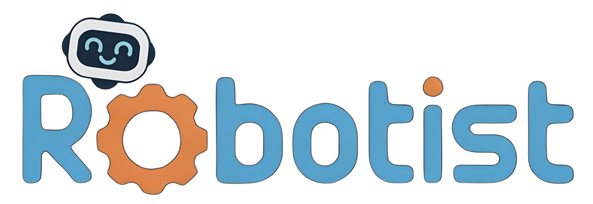
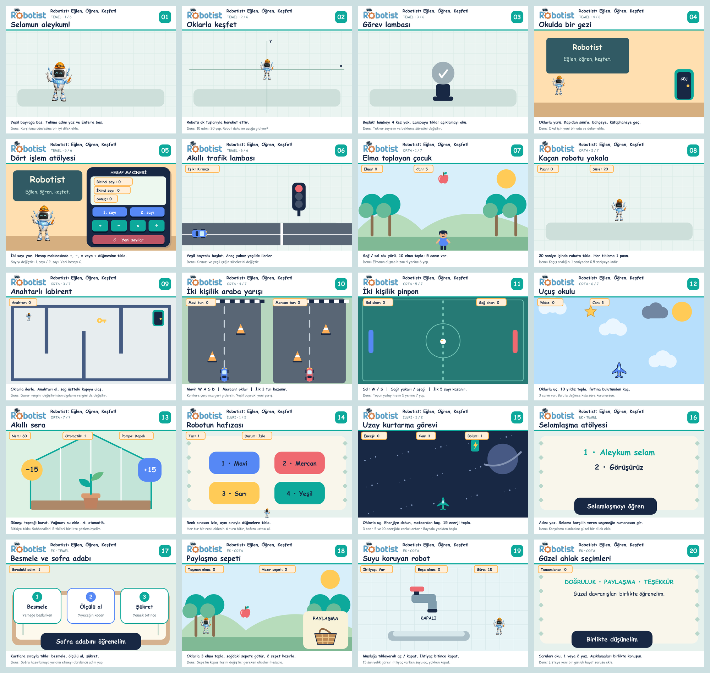

# Robotist: Eğlen, Öğren, Keşfet!

Çocuklar için **20 düzenlenebilir Scratch projesi**: 8 temel, 10 orta ve 2 ileri seviye etkinlik.

## Görselden seç, tek tek indir

### [Projeleri gör ve Scratch dosyanı indir](https://sultanamed.github.io/robotist-20-scratch-projesi/)

Her proje kartında sahne görseli, seviye, öğrenilecek konular, oynama açıklaması ve **Scratch dosyasını indir** düğmesi var. Her indirme yalnızca seçilen **.sb3** dosyasıdır. GitHub hesabı gerekmez.

## Nasıl açarım?

1. İstediğin projenin **Scratch dosyasını indir** düğmesine bas.
2. [Scratch editörünü](https://scratch.mit.edu/projects/editor/) veya bilgisayarındaki Scratch 3 uygulamasını aç.
3. **Dosya → Bilgisayarından yükle** seçeneğine bas ve indirdiğin `.sb3` dosyasını seç.
4. **Yeşil bayrağa** tıkla. Oyna, blokları incele, bir şeyi değiştir ve yeniden dene!

İlk kez başlıyorsan **01 - Selamun aleykum!** projesini seç. İsim sorusunda bir takma ad yazabilirsin. Scratch 3 masaüstü uygulamasıyla projeler çevrimdışı kullanılabilir. Kamera, mikrofon veya robot donanımı gerekmez.

## Projeler

Aşağıdaki sıra kolaydan zora önerilen çalışma sırasıdır; dosya numaraları korunmuştur.

| Dosya | Proje | Seviye | Scratch dosyası |
|---|---|---|---|
| 01 | Selamun aleykum! | Temel | [İndir](https://github.com/sultanamed/robotist-20-scratch-projesi/raw/refs/heads/main/01_Selamun_Aleykum.sb3) |
| 16 | Selamlaşma atölyesi | Temel | [İndir](https://github.com/sultanamed/robotist-20-scratch-projesi/raw/refs/heads/main/16_Selamlasma_Atolyesi.sb3) |
| 02 | Oklarla keşfet | Temel | [İndir](https://github.com/sultanamed/robotist-20-scratch-projesi/raw/refs/heads/main/02_Oklarla_Kesfet.sb3) |
| 03 | Görev lambası | Temel | [İndir](https://github.com/sultanamed/robotist-20-scratch-projesi/raw/refs/heads/main/03_Gorev_Lambasi.sb3) |
| 17 | Besmele ve sofra adabı | Temel | [İndir](https://github.com/sultanamed/robotist-20-scratch-projesi/raw/refs/heads/main/17_Besmele_ve_Sofra_Adabi.sb3) |
| 04 | Okulda bir gezi | Temel | [İndir](https://github.com/sultanamed/robotist-20-scratch-projesi/raw/refs/heads/main/04_Okulda_Bir_Gezi.sb3) |
| 05 | Dört işlem atölyesi | Temel | [İndir](https://github.com/sultanamed/robotist-20-scratch-projesi/raw/refs/heads/main/05_Dort_Islem_Atolyesi.sb3) |
| 06 | Akıllı trafik lambası | Temel | [İndir](https://github.com/sultanamed/robotist-20-scratch-projesi/raw/refs/heads/main/06_Akilli_Trafik_Lambasi.sb3) |
| 07 | Elma toplayan çocuk | Orta | [İndir](https://github.com/sultanamed/robotist-20-scratch-projesi/raw/refs/heads/main/07_Elma_Toplayan_Cocuk.sb3) |
| 18 | Paylaşma sepeti | Orta | [İndir](https://github.com/sultanamed/robotist-20-scratch-projesi/raw/refs/heads/main/18_Paylasma_Sepeti.sb3) |
| 08 | Kaçan robotu yakala | Orta | [İndir](https://github.com/sultanamed/robotist-20-scratch-projesi/raw/refs/heads/main/08_Kacan_Robotu_Yakala.sb3) |
| 09 | Anahtarlı labirent | Orta | [İndir](https://github.com/sultanamed/robotist-20-scratch-projesi/raw/refs/heads/main/09_Anahtarli_Labirent.sb3) |
| 10 | İki kişilik araba yarışı | Orta | [İndir](https://github.com/sultanamed/robotist-20-scratch-projesi/raw/refs/heads/main/10_Iki_Kisilik_Araba_Yarisi.sb3) |
| 11 | İki kişilik pinpon | Orta | [İndir](https://github.com/sultanamed/robotist-20-scratch-projesi/raw/refs/heads/main/11_Iki_Kisilik_Pinpon.sb3) |
| 12 | Uçuş okulu | Orta | [İndir](https://github.com/sultanamed/robotist-20-scratch-projesi/raw/refs/heads/main/12_Ucus_Okulu.sb3) |
| 13 | Akıllı sera | Orta | [İndir](https://github.com/sultanamed/robotist-20-scratch-projesi/raw/refs/heads/main/13_Akilli_Sera.sb3) |
| 19 | Suyu koruyan robot | Orta | [İndir](https://github.com/sultanamed/robotist-20-scratch-projesi/raw/refs/heads/main/19_Suyu_Koruyan_Robot.sb3) |
| 20 | Güzel ahlak seçimleri | Orta | [İndir](https://github.com/sultanamed/robotist-20-scratch-projesi/raw/refs/heads/main/20_Guzel_Ahlak_Secimleri.sb3) |
| 14 | Robotun hafızası | İleri | [İndir](https://github.com/sultanamed/robotist-20-scratch-projesi/raw/refs/heads/main/14_Robotun_Hafizasi.sb3) |
| 15 | Uzay kurtarma görevi | İleri | [İndir](https://github.com/sultanamed/robotist-20-scratch-projesi/raw/refs/heads/main/15_Uzay_Kurtarma_Gorevi.sb3) |

## Neler öğreneceğiz?

- Komut sırası, isim girişi, algılama ve konuşma.
- Hareket, sahne değiştirme, koşullar ve dört işlem.
- İki kişilik araba yarışı, pinpon ve uçuş oyunu.
- Sensör benzetimi, değişkenler, listeler, özel bloklar ve ikizler.
- Selamlaşma, paylaşma, sofra adabı, güzel ahlak ve suyu koruma.

Trafik, sera ve su etkinlikleri birer simülasyondur. Görseller sahne önizlemeleridir. Robotist logosu ve robot maskotu eğitim setinin parçasıdır.

## Hareketli oyun önizlemeleri

20 projenin her biri için 4 karelik, 9,8 saniyelik GIF bulunur. Sayfadaki önizlemeler yalnız görünürken oynar; durdurma düğmesi ve azaltılmış hareket tercihi desteklenir. Her karenin altında ne olduğunu açıklayan kısa bir cümle vardır.

Kareler, Scratch VM 5.0.300 üzerinde kullanıcı girdileriyle çalıştırılan projelerin gerçek konum, kostüm, konuşma ve değişken durumlarından özgün proje varlıklarıyla çizildi. Bu bir ekran kaydı değildir. Zaman sanallaştırılmış, temas algılaması kostüm sınırlarıyla hesaplanmıştır. Gösterilen işlemler ve puanlar proje kodu tarafından üretilir. GIF dosyaları `onizleme/` içinde; kare açıklamaları `onizleme/gif_katalogu.json` dosyasındadır.

[Robotist ana sayfa](https://robotist.fun/)
